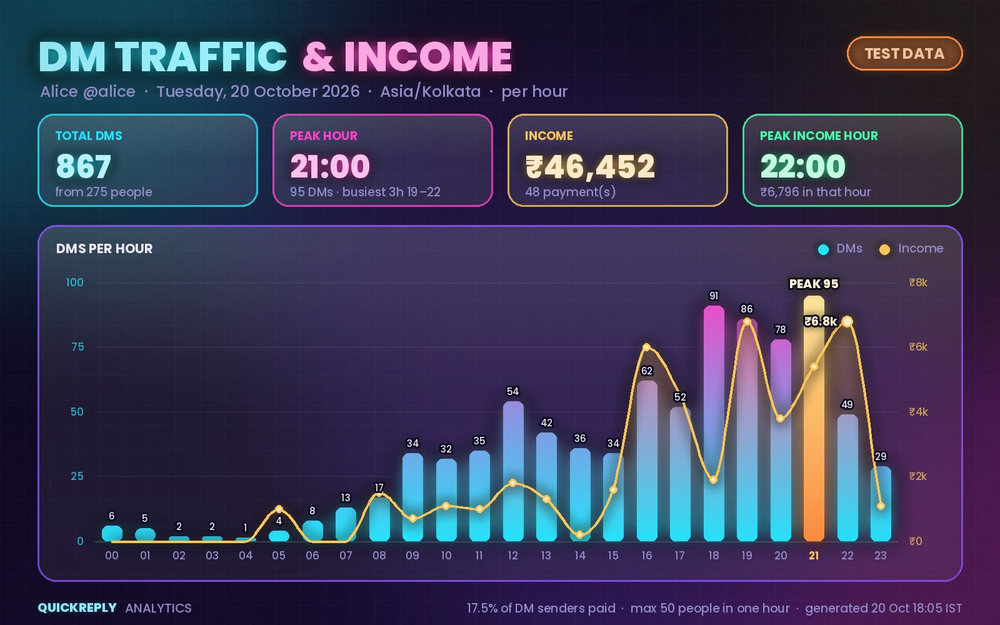

# QuickReply

A standalone Telegram **userbot** (Telethon) that runs on your own account and handles:

- **Quick replies & greetings**: keeps the `/demo` Business quick reply's invite link current, sends a greeting/away reply to first-time DMs while you're offline, `/broadcast`, and `L` (clear + block).
- **Payment logger**: `/add <amount> <name>` sends the private receipt, posts the proof to your payment channel and tracks daily stats.
- **Account backup / restore**: `.save` copies your profile, Business setup and every quick reply into MongoDB. `.setup` applies a saved backup to another account.
- **Payment-screenshot archives**: one ZIP per Asia/Kolkata day is delivered to `@ohthatsthepoint`. The source screenshots are deleted only after that delivery is verified.
- **Publishing**: `.post`, `.postbatch` and `.postnow` publish screenshot ZIPs to a posting channel you choose.
- **DM analytics**: `.graph` renders a neon glow card of DMs and INR per hour, so you can see your peak hours.

This project is independent of ChannelGuard. It doesn't import or modify ChannelGuard code. The keyword / admin-bot link-reservation part of the old `/add` (`/add <amt> <name> <keywords…>`, `{link}`) was removed on purpose.

## Requirements

- Python 3.10+ (Windows, Linux or macOS)
- A MongoDB database (e.g. a free MongoDB Atlas cluster)
- Telegram `API_ID` / `API_HASH` from <https://my.telegram.org> → *API development tools*
- **Telegram Premium** for quick replies and Business features (Telegram's restriction). The payment logger and archives work without Premium.

## Install

```bash
git clone <this repo> QuickReply && cd QuickReply
python setup.py            # menu; choose [1] Install / Configure
```

The installer goes through these steps:

1. Checks Python, the OS, the dependencies, and any existing `.env` or session.
2. Asks only for the values that are **missing**. If it finds an old ChannelGuard checkout next to this folder, it offers to reuse its `API_ID`/`API_HASH`, `quickreply.session` and QuickReply data (templates, payment channel, payment log, greeting).
3. Runs `pip install -r requirements.txt`. If a package is already installed at a different version, it asks before replacing it.
4. Connects to MongoDB, creates the indexes, then does a write/read/delete test.
5. Reuses the authorised Telegram session if one exists. Otherwise it runs Telegram's normal login (phone → code → 2FA password). Codes and passwords go straight to Telegram and are never stored or printed. It then checks that the account can post to the archive and posting channels, without sending anything.
6. Makes sure `.env` and `sessions/` are git-ignored, and that `.env.example` only contains placeholders.
7. Prints a coloured completion report.

You can run it again safely. Existing `.env` values are never changed without a `y` confirmation, and a working session is reused. Secrets are always hidden.

## Configuration (`.env`)

| Variable | Why it is needed |
|---|---|
| `MONGO_URL` | The only database setting, used for all persistent data. If the URI has a database path (`…mongodb.net/mydb`), that database is used. Otherwise QuickReply uses `quickreply`. Collections and indexes are created automatically. |
| `API_ID` | Telegram application id. The Telegram API requires it for a user login. |
| `API_HASH` | Telegram application hash. Required together with `API_ID`. |

Nothing else goes in `.env`. Channels, templates and percentages are stored per account in MongoDB and set with chat commands.

## Run

```bash
python quickreply.py                    # sessions/quickreply.session
python quickreply.py --session second   # another account, sessions/second.session
```

If the session isn't logged in yet, the normal Telegram login starts in the terminal. Stop with Ctrl+C. You can only run one QuickReply per account per machine (a process lock enforces this).

## Commands

QuickReply only reads commands you type yourself (outgoing messages). Incoming messages, forwarded messages and other people's usernames can never trigger a command. Admin commands only work in **Saved Messages**. Slash commands typed in a chat with a bot (`/start`, `/cancel`, `/clear`…) are left for that bot.

### Payment logger (any chat)
| Command | Effect |
|---|---|
| `/add <amount> <name>` | Reply to the payment screenshot. Records the payment, edits your command into the receipt (`/setdone` template), posts the proof to the payment channel, and adds the screenshot to that day's archive. |
| `/setdone <text>` or reply to a post | Template for the private receipt. Replying to a formatted post keeps its bold, links and premium emoji. |
| `/setchannelpostofpayment <text>` | Caption template for the payment-channel post. |
| `.setchannel [id\|@username]` | Sets the payment channel (type it inside the channel, or name it). Pending posts move to the new channel. |
| `/stats`, `/clear` | Today's total, count and split / remove today's payments from the stats. |
| `/cancel` | Reply to a payment post in the channel: it is marked **FAKE PAYMENT** and excluded from the stats. |
| `.unban <id\|@username>` | Lifts that user's ban in every group/channel you admin. |

Template tokens: `{amount} {name} {orderid} {rioshare} {marco} {total} {todaytotal}`.

### Backup / restore (Saved Messages)
| Command | Effect |
|---|---|
| `.save` | Full backup to MongoDB, then verification (see below). If nothing changed, no duplicate is stored. |
| `.backups` | Lists backups (id, account, kind, status). |
| `.setup` | Lists the accounts you can restore from. The target is always the account you type it on. |
| `.setup <account id\|backup id>` | **Preview only**: what would change, what is already correct, and what isn't supported. Gives you a confirmation code. |
| `.setup confirm <code>` | Valid for 10 minutes, once. Takes a pre-restore backup of this account first, applies the changes, then re-reads the account to verify. |
| `.setup cancel` | Throws away the pending confirmation. |

To restore account A onto account B, run `.save` on A. Then start QuickReply on B with the same `MONGO_URL` (`--session b`), and run `.setup <A's id>` followed by `.setup confirm <code>`. The report ends with `Rollback: .setup <pre-restore backup id>`.

### Archives & publishing (Saved Messages)
| Command | Effect |
|---|---|
| `.archive` / `.archive run` / `.archive on\|off` | Shows status / seals finished days now / turns daily archiving on or off. |
| `.setarchive <@channel\|id>` | Archive destination. Default `@ohthatsthepoint`. |
| `.setpostchannel [@channel\|id]` | Posting channel for `.post*`. It has no default and must be set explicitly. |
| `.postcaption <text>` | Caption template: `{date} {pretty_date} {part} {parts} {count}`. The date is always included. |
| `.post` | Reply to one screenshot ZIP to publish it. `.post force` publishes a different ZIP for a date that was already posted. |
| `.postbatch` | Reply to the first ZIP of a series: every ZIP from there up to the command is processed, oldest date first. `.postbatch <N>` uses the last N ZIPs instead. |
| `.postnow [YYYY-MM-DD]` | Checks the posting channel and your rights there, then publishes every pending job, oldest first: delivered daily archives plus unfinished `.post`/`.postbatch` jobs. |

### DM analytics (Saved Messages)


| Command | Effect |
|---|---|
| `.graph` | Today's card, live so far (Asia/Kolkata hours). Sent to Saved Messages with a text summary. |
| `.graph yesterday` / `.graph YYYY-MM-DD` | Any earlier day still in storage. |
| `.graph scan [day]` | Reads that day's DMs from your chat history first, which picks up DMs that arrived while QuickReply was offline, then renders the card. Already-counted messages are never counted twice. |
| `.tgraph` | Test card with made-up data. Nothing is read or stored. |

The card shows:
- DMs per hour as glowing bars, with the peak hour highlighted
- income (INR) per hour as a gold line
- total DMs and unique people
- the peak DM hour and the busiest 3-hour window
- total income and the peak income hour
- the share of DM senders who paid
- a "now" marker on today's card

What counts as a DM: every incoming private message from a real user. Bots, Telegram's service account, your own account and the `.linksource` account are excluded. Only the sender id, message id and time are stored, never the text. Rows are deleted automatically after 180 days. Switch tracking off with `.config dm_tracking off`.

Income per hour comes from `/add` payments. Payments reset with `/clear` still count, because that money really arrived; fake and failed payments don't.

### Other
`/set` (reply to a post) · `/unset` · `/show` · `/away on|off|status` · `/broadcast 9:30 AM 18 JUL THANKS FOR` (reply to a post) · `.linksource <@user|id|off>` (the only sender whose invite links update `/demo`) · `.config [key value]` (`rio_pct marco_pct share_base order_prefix order_id_length online_minutes shortcut relay_link swap_greeting archive_enabled dm_tracking`) · `L` in a private chat · `.ping` · `.help`

## What `.save` stores

The backup is one MongoDB document (schema version, account id, creation time, status `complete`/`partial`, a content fingerprint). Media bytes are kept in GridFS and deduplicated by SHA-256.

- **Profile**: first/last name, username (plus the collectible usernames list), bio, birthday, personal channel, name colour, profile colour and background emoji, emoji status, up to 50 profile photos including video avatars, and the public fallback photo.
- **Business**: opening hours, location, intro, greeting and away messages (stored with their quick-reply names so they can be re-linked), and chat links.
- **Quick replies**: every shortcut and its command, in order. Each message keeps its order, text, formatting entities, custom-emoji ids, links, inline buttons (as data), captions, albums, and photos/documents (bytes ≤ 50 MB), plus geo, venue, contact and dice messages.
- **QuickReply settings**: templates, split percentages, the order-id format, channel settings, and the `/set` greeting post.

Every field gets a status: `saved`, `empty`, `unsupported` (with the reason) or `failed`. If any field fails, the backup is marked **partial**. After storing, the document is read back and every media object's checksum is checked.

## Storage (MongoDB)

| Collection | Contents |
|---|---|
| `accounts` | Accounts that ran QuickReply. Only these can be used as `.setup` sources. |
| `settings` | Runtime settings, one per account. |
| `payments`, `greeted` | Payment log and greeted users. |
| `backups`, `media.*` (GridFS) | `.save` backups and their media. |
| `screenshots`, `screenshots_fs.*` | Screenshots waiting for their daily ZIP. |
| `archives`, `archives_fs.*` | Daily archive manifests, ZIPs and delivery/post state. |
| `post_jobs` | Posting jobs with per-item and per-album state. |
| `dm_events` (TTL 180 days) | One row per incoming DM for `.graph`: sender id, message id, time. No text. |
| `restore_sessions` (TTL), `restore_history`, `audit`, `command_claims` (TTL) | Confirmations, restore reports, a minimal audit trail, and once-only command execution. |

Timestamps are UTC. Day boundaries use Asia/Kolkata. Login codes, 2FA passwords and session data are never written to MongoDB.

## Screenshot archives

- **Day** = Asia/Kolkata `00:00:00` (inclusive) to the next `00:00:00` (exclusive). For example, `2026-10-20` covers 2026-10-19 18:30 UTC up to, but not including, 2026-10-20 18:30 UTC.
- **Date assignment**: a screenshot belongs to the day its proof message was *received* (the Telegram timestamp), not the day `/add` ran. A proof received at 23:59 and logged at 00:05 stays on the earlier day. If that day's ZIP was already delivered, the late screenshot goes into `payment_screenshots_<date>_part2.zip`.
- A day is sealed only after it has ended. The ZIP (`payment_screenshots_YYYY-MM-DD.zip`) holds the original image bytes plus `manifest.json`: date, window, creation time, count, and a SHA-256 for each item. File names and captions never contain payment details. The ZIP is re-opened and checked against the manifest, stored in GridFS, and read back.
- **Delivery** goes to the archive channel. The delivered document is fetched again and its size and filename are compared before it counts as delivered. If the process crashes after Telegram accepts the upload but before the result is recorded, the next attempt searches the channel for the document before sending again.
- **Deletion**: only after verified delivery are that archive's screenshot records, their GridFS files and the local ZIP deleted. An audit record keeps the date, count, checksum and delivered message id. If building, storing or delivery fails, all sources are kept and the step is retried with back-off.

## Posting workflow

Every ZIP is validated first. QuickReply rejects files over 200 MB, more than 1000 entries, path traversal, absolute paths, symlinks, encrypted entries, executables (by extension and by content), ZIP bombs, and invalid manifests or checksums. The date comes from the manifest, or from the file name if there's no manifest. If the two disagree, the ZIP is rejected. Non-image files are listed as "not posted". Images are written to a private temporary folder (`0700`), which is always removed afterwards.

Each ZIP becomes one `post_jobs` document keyed by its SHA-256, so the same archive can't be queued twice. Photos are sent as albums of up to 10, in order, with the date in every caption. WEBP files and images over 10 MB are sent as files.

- Before each album is uploaded, it is marked `sending`. After a crash or network error, that album is matched against your recent posts (by exact caption) and is not re-sent if it's found.
- If Telegram rejects an album, each image is retried on its own.
- A failed image is never marked as published.
- Short flood waits are slept through. Long ones pause the job, and `.postnow` resumes it.
- Leases in MongoDB stop two workers from processing the same job.

## Telegram API limitations

- Quick replies, Business features, emoji status and profile colours need **Premium** on the account being restored to. Without Premium they are reported as `unsupported`.
- **Inline buttons** can't be attached by a user account. They are kept in the backup and reported when restoring.
- A **username** still owned by the source account can't be taken by the target (`USERNAME_OCCUPIED`, reported as failed). Collectible usernames can't be transferred.
- **Saved locations**, **collectible gifts / profile decorations**, **stories**, **privacy rules** and the **phone number** can't be backed up through this API layer. They are listed as `unsupported`.
- Restored **business chat links** get new `t.me/m/…` URLs. The **intro sticker** may not be re-referenced from another account.
- Greeting/away recipient lists only keep users the target account can reach.
- Telegram re-encodes uploaded photos. A restored photo is recognised later by the photo id recorded when it was uploaded, so repeated restores don't upload it again.

## Credits

The `.graph` card uses the bundled [Poppins](https://github.com/itfoundry/Poppins) font (SIL Open Font License, `qr/assets/fonts/OFL.txt`). Bundling it means the card looks the same on Windows and Linux, and the ₹ sign renders.

## Tests

```bash
pip install -r requirements-dev.txt
QR_TEST_MONGOD=/path/to/mongod pytest      # or QR_TEST_MONGO_URL=mongodb://localhost:27017/
```

The tests run against an in-memory fake of Telegram and a throwaway real `mongod`. If neither variable is set and `mongod` isn't on `PATH`, the MongoDB tests are skipped. No real screenshots are used or published. For a live check, set a private test channel with `.setpostchannel` and use synthetic images.
